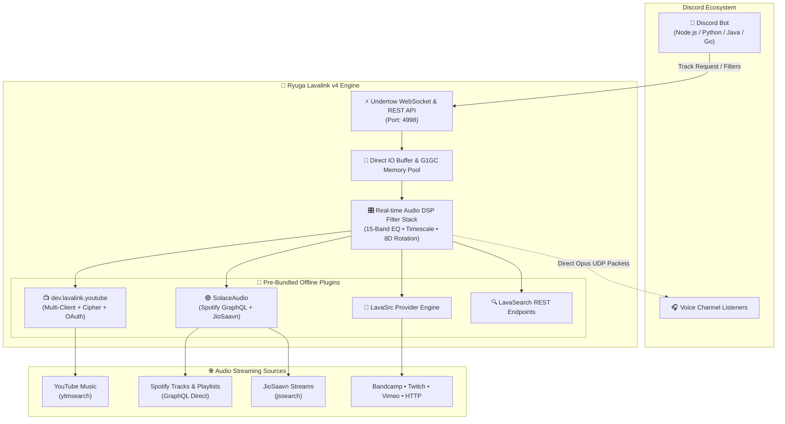

<div align="center">

```ascii
  ██████╗ ██╗   ██╗██╗   ██╗ ██████╗  █████╗ 
  ██╔══██╗╚██╗ ██╔╝██║   ██║██╔════╝ ██╔══██╗
  ██████╔╝ ╚████╔╝ ██║   ██║██║  ███╗███████║
  ██╔══██╗  ╚██╔╝  ██║   ██║██║   ██║██╔══██║
  ██║  ██║   ██║   ╚██████╔╝╚██████╔╝██║  ██║
  ╚═╝  ╚═╝   ╚═╝    ╚═════╝  ╚═════╝ ╚═╝  ╚═╝
     ⚡ L A V A L I N K   v 4   N O D E ⚡
```

# 👑 RYUGA • LAVALINK v4
### *The Ultimate High-Performance Standalone Discord Audio Node*

[](https://github.com/lavalink-devs/Lavalink)
[](https://adoptium.net/)
[](#-bundled-plugins)
[](#-docker-deployment)
[](LICENSE)

<br/>

[](https://github.com/sridharanry-star/lavalink/stargazers)
[](https://github.com/sridharanry-star/lavalink/network/members)
[](https://github.com/sridharanry-star/lavalink/watchers)

<br/>

<p align="center">
  A <b>battle-tested, turnkey Lavalink v4.2.2 audio server</b> engineered for extreme uptime, pristine audio fidelity, and zero external build failures.
  <br/>
  Featuring <b>100% Offline Local Plugin Bundling</b>, <b>YouTube OAuth & Remote Cipher Bypass</b>, and <b>SolaceAudio GraphQL Integration</b> for unlimited Spotify and Indian music streaming.
</p>

---

[✨ Key Features](#-key-features) •
[📊 Architecture](#-architecture) •
[⚡ Comparison](#-standard-vs-ryuga-lavalink) •
[🧩 Plugins](#-bundled-plugins) •
[🚀 Quick Start](#-quick-start) •
[🐳 Docker](#-docker-deployment) •
[🎛️ Audio Filters](#-audio-filter-presets) •
[🔌 Client Libraries](#-client-integration) •
[🛠️ Systemd](#-production-systemd-service) •
[❓ FAQ](#-troubleshooting--faq)

---

</div>

<br/>

## ✨ Key Features

- ⚡ **Zero Remote Dependencies (Offline Boot)**:
  Plugins are packaged as local JARs in [`./plugins/`](./plugins/). Boots instantaneously without querying JitPack, GitHub Releases, or Maven Central — immune to third-party dependency outages.
- 📺 **Next-Gen YouTube & YouTube Music Engine**:
  - Multi-client fallback rotation: `MUSIC`, `ANDROID_MUSIC`, `TV`, `TVHTML5_SIMPLY`, `WEBEMBEDDED`, `IOS`, `MWEB`.
  - YouTube OAuth integration for playing age-restricted and member-only tracks.
  - Remote Cipher integration (`cipher.kikkia.dev`) to bypass YouTube's signature decipher changes without server restarts.
- 🟢 **SolaceAudio GraphQL (Spotify & JioSaavn)**:
  - Direct GraphQL resolution — **No Spotify Developer API App or Spotify Premium subscription required**!
  - No rate limits or developer quota expirations.
  - Native JioSaavn search (`jssearch:`) and seamless YouTube Music fallback.
- 🎛️ **Studio Audio DSP Engine**:
  Real-time hardware-friendly filters: 15-band Equalizer, Karaoke, Timescale (Nightcore/Vaporwave), 8D Audio Rotation, Tremolo, Vibrato, Distortion, and Low-Pass filter.
- 🏎️ **Hyper-Tuned Undertow Engine**:
  Direct buffer allocations, custom worker threads, and tuned buffer intervals (`400ms` / `5000ms` frame buffer) for silky smooth streaming without audio jitter.

<br/>

---

## 📊 Architecture



<br/>

---

## ⚡ Standard vs Ryuga Lavalink

| Feature | Standard Lavalink | 👑 Ryuga Lavalink v4 |
| :--- | :---: | :---: |
| **Plugin Loading** | Remote downloads via JitPack *(prone to build timeouts & downtime)* | **100% Pre-bundled Local JARs** *(instant offline boot)* |
| **Spotify Playback** | Requires Spotify Developer credentials & hits strict API limits | **Internal GraphQL** *(no Spotify App or Premium required)* |
| **JioSaavn Audio** | ❌ Unsupported natively | **Built-in Native Support** (`jssearch:`) |
| **YouTube 429 Bypass** | Fails on IP throttles & signature changes | **Remote Cipher + Multi-client fallback + OAuth** |
| **Large File Push** | Fails with GitHub 100MB limit | **Configured with Git LFS** |
| **Memory Optimization** | Default JVM parameters | **G1GC Low-Pause Collector (`-XX:+UseG1GC`)** |

<br/>

---

## 🧩 Bundled Plugins

All plugins are pre-installed in [`plugins/`](./plugins/) and configured to load with zero network requests:

| Plugin | Version | Capabilities | Description |
| :--- | :---: | :--- | :--- |
| **`solaceaudio-plugin`** | `1.0.18` | Spotify, JioSaavn | GraphQL engine bypassing Spotify Developer limits and Premium restrictions |
| **`ryuga-youtube-plugin`** | `v4` | YouTube, YouTube Music | Multi-client rotation with Cipher deciphering & OAuth refresh |
| **`ryuga-lavasrc-plugin`** | `4.3.0` | Extended Sources | Universal provider metadata resolver |
| **`ryuga-lavasearch-plugin`** | `v4` | Search APIs | Specialized search endpoints for playlists, albums, and artists |

<br/>

---

## 📁 Repository Structure

```plaintext
├── application.yml                 # Active server config (Safe Mode / Ignored in Git)
├── application.example.yml         # Sanitized configuration template for public deployment
├── Lavalink.jar                    # Tuned Lavalink v4.2.2 executable (Git LFS)
├── Dockerfile                      # Production Docker container build
├── docker-compose.yml              # 1-command container deployment
├── start.bat                       # Windows 1-click startup runner
├── start.sh                        # Linux/macOS startup runner
├── plugins/                        # Bundled plugin JARs (offline loaded)
│   ├── ryuga-lavasearch-plugin.jar
│   ├── ryuga-lavasrc-plugin.jar
│   ├── ryuga-youtube-plugin.jar
│   └── solaceaudio-plugin-1.0.18.jar
├── lavalink-plugins/               # Plugin metadata & properties
│   └── lavasrc-plugin.properties
├── .gitattributes                  # Git LFS configuration
├── .gitignore                      # Safe credential shielding rules
└── README.md                       # Documentation & reference manual
```

<br/>

---

## 🚀 Quick Start

### Prerequisites

- **Java 17 or Java 21+ LTS** (64-bit recommended)
  - Download from [Eclipse Adoptium Temurin](https://adoptium.net/) or [Oracle](https://www.oracle.com/java/technologies/downloads/).
  - Verify your installation:
    ```bash
    java -version
    ```

### 1. Launching

#### 🪟 Windows (1-Click)
Double-click `start.bat` or run:
```bat
start.bat
```

#### 🐧 Linux / macOS
Grant execution permissions and execute:
```bash
chmod +x start.sh
./start.sh
```

#### ⌨️ Manual Command Line
```bash
java -Xmx2G -XX:+UseG1GC -XX:+ParallelRefProcEnabled -jar Lavalink.jar
```

The node will bind to `0.0.0.0:4998` with password `ryugalavalink` (or your configured settings in `application.yml`).

<br/>

---

## 🐳 Docker Deployment

Run your Lavalink node inside an isolated, lightweight container in seconds:

### Using Docker Compose (Recommended)
```bash
docker compose up -d
```

### Build & Run Manually
```bash
# Build image
docker build -t ryuga-lavalink:v4 .

# Run container
docker run -d \
  --name ryuga-lavalink \
  -p 4998:4998 \
  -v $(pwd)/application.yml:/opt/lavalink/application.yml \
  --restart unless-stopped \
  ryuga-lavalink:v4
```

View live logs:
```bash
docker logs -f ryuga-lavalink
```

<br/>

---

## 🎛️ Audio Filter Presets

Lavalink supports real-time audio manipulation via REST and WebSocket filter payloads. Here are popular presets:

<details>
<summary><b>🔊 Bass Boost (High Punch)</b></summary>
<br/>

```json
{
  "equalizer": [
    { "band": 0, "gain": 0.35 },
    { "band": 1, "gain": 0.30 },
    { "band": 2, "gain": 0.25 },
    { "band": 3, "gain": 0.15 },
    { "band": 4, "gain": 0.05 }
  ]
}
```
</details>

<details>
<summary><b>🌙 Nightcore (Fast & High Pitch)</b></summary>
<br/>

```json
{
  "timescale": {
    "speed": 1.25,
    "pitch": 1.3,
    "rate": 1.0
  }
}
```
</details>

<details>
<summary><b>🌊 Vaporwave (Slow & Deep Pitch)</b></summary>
<br/>

```json
{
  "timescale": {
    "speed": 0.85,
    "pitch": 0.8,
    "rate": 1.0
  }
}
```
</details>

<details>
<summary><b>🎧 8D Audio Rotation</b></summary>
<br/>

```json
{
  "rotation": {
    "rotationHz": 0.2
  }
}
```
</details>

<details>
<summary><b>🎤 Karaoke (Vocal Suppression)</b></summary>
<br/>

```json
{
  "karaoke": {
    "level": 1.0,
    "monoLevel": 1.0,
    "filterBand": 220.0,
    "filterWidth": 100.0
  }
}
```
</details>

<br/>

---

## 🔌 Client Integration

Connect any leading Discord audio library to your node:

### 🟩 Node.js (Kazagurumo / Poru / Discord.js)
```javascript
const { Kazagurumo } = require("kazagurumo");
const Spotify = require("kazagurumo-spotify");

const Nodes = [
  {
    name: "Ryuga-Node",
    url: "localhost:4998",
    auth: "ryugalavalink",
    secure: false
  }
];

const kazagurumo = new Kazagurumo({
  defaultSearchEngine: "youtube_music",
  send: (guildId, payload) => {
    const guild = client.guilds.cache.get(guildId);
    if (guild) guild.shard.send(payload);
  }
}, new Connectors.DiscordJS(client), Nodes);
```

### 🐍 Python (Wavelink / Discord.py)
```python
import discord
from discord.ext import commands
import wavelink

bot = commands.Bot(command_prefix="!", intents=discord.Intents.all())

@bot.event
async def on_ready():
    node = wavelink.Node(
        uri="http://localhost:4998",
        password="ryugalavalink"
    )
    await wavelink.Pool.connect(nodes=[node], client=bot)
    print("👑 Connected to Ryuga Lavalink Node")
```

### ☕ Java (Lavalink-Client / JDA)
```java
LavalinkClient client = new LavalinkClient(userId);
client.addNode(
    new NodeOptions.Builder()
        .setName("Ryuga-Node")
        .setServerUri(URI.create("ws://localhost:4998"))
        .setPassword("ryugalavalink")
        .build()
);
```

<br/>

---

## 🛠️ Production Systemd Service

To run Lavalink 24/7 with auto-recovery on Ubuntu / Debian:

1. Create service unit:
   ```bash
   sudo nano /etc/systemd/system/lavalink.service
   ```
2. Paste unit configuration:
   ```ini
   [Unit]
   Description=Ryuga Lavalink v4 Audio Node
   After=network.target

   [Service]
   Type=simple
   User=root
   WorkingDirectory=/opt/lavalink
   ExecStart=/usr/bin/java -Xmx2G -XX:+UseG1GC -XX:+ParallelRefProcEnabled -jar Lavalink.jar
   Restart=always
   RestartSec=5
   StandardOutput=journal
   StandardError=journal
   SyslogIdentifier=lavalink

   [Install]
   WantedBy=multi-user.target
   ```
3. Enable and start:
   ```bash
   sudo systemctl daemon-reload
   sudo systemctl enable --now lavalink
   sudo journalctl -u lavalink -f
   ```

<br/>

---

## ❓ Troubleshooting & FAQ

<details>
<summary><b>1. YouTube 429 (Too Many Requests) or "Sign in to confirm you're not a bot"</b></summary>
<br/>
YouTube throttles cloud VPS IP addresses. To resolve:
- Verify <code>remoteCipher</code> is enabled in <code>application.yml</code>.
- Provide a valid <code>refreshToken</code> under <code>plugins.youtube.oauth</code>.
- Use a residential proxy or IPv6 block in your Lavalink configuration.
</details>

<details>
<summary><b>2. "Unsupported major.minor version" error</b></summary>
<br/>
Lavalink v4 requires <b>Java 17 or higher</b> (Java 21 LTS strongly recommended). Run <code>java -version</code> and update your JDK using Eclipse Adoptium.
</details>

<details>
<summary><b>3. Port already in use (BindException: Address already in use)</b></summary>
<br/>
Change <code>server.port</code> in <code>application.yml</code> to another free port (e.g., <code>2333</code> or <code>8080</code>), or terminate any orphaned Java processes with:
<br/>
<b>Windows:</b> <code>taskkill /F /IM java.exe</code><br/>
<b>Linux:</b> <code>sudo fuser -k 4998/tcp</code>
</details>

<details>
<summary><b>4. How to protect my secrets when pushing to GitHub?</b></summary>
<br/>
<code>application.yml</code> is added to <code>.gitignore</code> by default. Always keep your personal tokens in <code>application.yml</code> and share only <code>application.example.yml</code>.
</details>

<br/>

---

## 🔒 Security Best Practices

> [!WARNING]
> - **Change the Default Password**: Change `lavalink.server.password` before making your server public.
> - **Protect Spotify & OAuth Tokens**: Never commit your `spDc` cookie or Google `refreshToken` to public repositories.
> - **Firewall Protection**: Bind to `127.0.0.1` if your bot and Lavalink reside on the same server, or configure a firewall (`ufw`) to allow traffic only from your bot's IP address.

---

<div align="center">
  <sub>Engineered for uncompromising reliability and fidelity. Crafted with ❤️ by <a href="https://github.com/sridharanry-star">RYUGA</a>.</sub>
</div>
